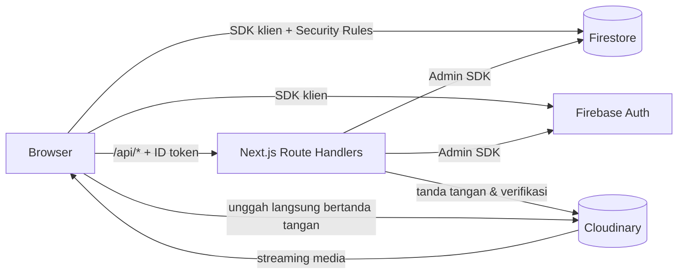
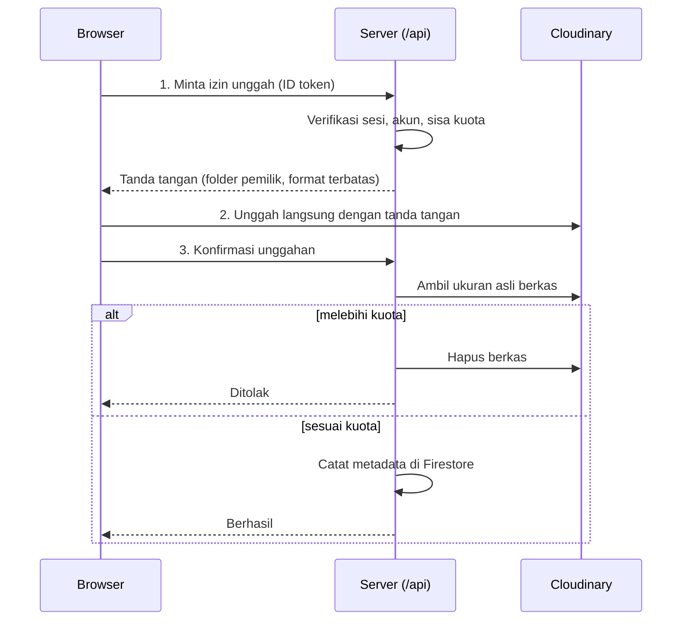

<div align="center">


# Gramofon

**Pemutar video & musik pribadi di browser — koleksi sendiri, playlist sendiri, di perangkat apa pun.**


[Fitur](#-fitur) · [Arsitektur](#-arsitektur) · [Mulai Cepat](#-mulai-cepat) · [Konfigurasi](#-konfigurasi) · [API](#-referensi-api) · [Keamanan](#-keamanan) · [Peta Jalan](#-peta-jalan)

</div>

---

## Ringkasan

Gramofon adalah aplikasi web untuk mengunggah, mengelola, dan memutar video serta
musik. Setiap pengguna memiliki perpustakaan (*Library*) dan playlist sendiri;
admin mengelola pengguna, kuota, dan katalog **Explore** yang dibagikan ke semua
pengguna.

Prinsip rancangan:

| Prinsip | Penerapan |
|---|---|
| **Firebase hanya untuk teks** | Firestore menyimpan profil & metadata. Tidak ada berkas media di Firebase. |
| **Semua media di Cloudinary** | Video, musik, thumbnail, dan foto profil diunggah langsung ke Cloudinary. |
| **Server sebagai penjaga** | Otorisasi, kuota, dan pembatasan pendaftaran ditegakkan di server, bukan hanya di UI. |
| **Mobile-first** | Dirancang untuk desktop, Android, dan iPhone, termasuk kontrol layar kunci. |

---

## ✨ Fitur

### Pemutar
- **Tiga mode tampilan:** Theater, Audio Only, dan Mini.
- **Visualizer nada** yang membaca suara asli (bukan animasi acak), simetris, dan disinkronkan dengan jeda keluaran audio perangkat.
- Playlist, antrean, lompat maju/mundur, kecepatan putar, dan penguat volume di atas 100%.
- **Kontrol layar kunci & notifikasi** lewat Media Session API (bergantung dukungan browser/OS).

### Koleksi pribadi
- Unggah video/musik langsung ke Cloudinary dengan **kuota per pengguna**.
- **Playlist** dengan pengurutan drag (mouse & sentuhan) atau tombol ▲▼; urutan Library ikut tersimpan.
- Jendela daftar media untuk memilih isi dan mengurutkan sekaligus.

### Explore
- Katalog bersama yang dikelola admin: **kategori**, thumbnail, urutan, dan status tampil/tersembunyi.
- Media tersembunyi **tidak pernah dikirim** ke browser non-admin.

### Akun & administrasi
- Login **Email + Password** dan **Google**; registrasi dengan validasi dan username unik.
- Foto profil, notifikasi, dan halaman kontak.
- Panel admin: kelola pengguna, kuota, media, pengumuman, dan **saklar buka/tutup pendaftaran** (ditegakkan di server).
- Akun yang dinonaktifkan atau dicabut di Firebase otomatis dikeluarkan dari sesi.

---

## 🏗 Arsitektur



**Alur unggah bertanda tangan (signed upload)**



API Secret Cloudinary dan kunci admin Firebase **tidak pernah** meninggalkan server.

### Teknologi

| Lapisan | Teknologi |
|---|---|
| Framework | Next.js 16 (App Router), React 19 |
| Autentikasi & data | Firebase Authentication, Cloud Firestore |
| Server | Route Handlers Next.js, Firebase Admin SDK |
| Media | Cloudinary |
| Hosting | Vercel (disarankan) |
| Bahasa | JavaScript (ES Modules) |

---

## 🚀 Mulai Cepat

**Prasyarat:** Node.js ≥ 22, npm, akun Firebase, akun Cloudinary.

```bash
npm install
cp .env.local.example .env.local   # lalu isi nilainya (lihat Konfigurasi)
npm run dev
```

Buka <http://localhost:3000>.

| Perintah | Fungsi |
|---|---|
| `npm run dev` | Server pengembangan |
| `npm run build` | Build produksi |
| `npm run start` | Jalankan hasil build |
| `npm run lint` | Pemeriksaan lint |

> Sebelum mencoba login/unggah, selesaikan [Konfigurasi](#-konfigurasi) dan publikasikan `firestore.rules`.

---

## ⚙️ Konfigurasi

### Variabel lingkungan

Salin `.env.local.example` → `.env.local`. **Jangan meng-commit** berkas ini (sudah ada di `.gitignore`).

| Variabel | Lingkup | Sumber |
|---|---|---|
| `NEXT_PUBLIC_FIREBASE_API_KEY` | Publik | Firebase → Project settings → Your apps |
| `NEXT_PUBLIC_FIREBASE_AUTH_DOMAIN` | Publik | idem |
| `NEXT_PUBLIC_FIREBASE_PROJECT_ID` | Publik | idem |
| `NEXT_PUBLIC_FIREBASE_STORAGE_BUCKET` | Publik | idem |
| `NEXT_PUBLIC_FIREBASE_MESSAGING_SENDER_ID` | Publik | idem |
| `NEXT_PUBLIC_FIREBASE_APP_ID` | Publik | idem |
| `FIREBASE_ADMIN_PROJECT_ID` | 🔒 Server | Service account (JSON) |
| `FIREBASE_ADMIN_CLIENT_EMAIL` | 🔒 Server | Service account (JSON) |
| `FIREBASE_ADMIN_PRIVATE_KEY` | 🔒 Server | Service account (JSON), termasuk `\n` |
| `CLOUDINARY_CLOUD_NAME` | 🔒 Server | Cloudinary Dashboard |
| `CLOUDINARY_API_KEY` | 🔒 Server | Cloudinary Dashboard |
| `CLOUDINARY_API_SECRET` | 🔒 Server | Cloudinary Dashboard |

> Konfigurasi web Firebase (`NEXT_PUBLIC_*`) memang publik. Data dilindungi oleh **Security Rules** dan **Authorized domains**, bukan oleh kerahasiaan nilai ini. Rahasia **tidak boleh** diberi awalan `NEXT_PUBLIC_`.

### Firebase

1. Buat project Firebase.
2. **Authentication:** aktifkan *Email/Password* dan *Google*.
3. **Firestore:** buat database (mode production).
4. Isi `NEXT_PUBLIC_FIREBASE_*` dari *Project settings → Your apps*.
5. **Service account:** *Project settings → Service accounts → Generate new private key*; isi tiga variabel `FIREBASE_ADMIN_*`. Jangan simpan berkas JSON di repositori.
6. **Security Rules:** salin seluruh isi [`firestore.rules`](./firestore.rules) ke *Firestore → Rules*, lalu **Publish**.
   > Rules **tidak ter-deploy otomatis** bersama aplikasi. Publikasikan ulang setiap kali berkas berubah.
7. **Authorized domains:** daftarkan `localhost` dan domain produksi di *Authentication → Settings*.

### Cloudinary

1. Salin *Cloud name*, *API Key*, dan *API Secret* dari Dashboard ke `CLOUDINARY_*`.
2. **Tidak perlu** membuat *Upload Preset*; aplikasi memakai unggah bertanda tangan.
3. Paket gratis memakai **kredit bulanan bersama** (penyimpanan, bandwidth, transformasi), bukan kuota penyimpanan tetap. Pantau di Dashboard.

Folder aset: `gramofon-player` (media pengguna), `gramofon-explore`, `gramofon-explore-thumbs`, `gramofon-avatars`.

### Akun admin pertama

Peran admin sengaja tidak bisa diberikan lewat aplikasi:

1. Daftar akun lewat aplikasi.
2. Firestore → koleksi `users` → dokumen akun Anda.
3. Ubah field `role` menjadi `admin`.

### Deploy ke Vercel

1. Dorong repositori ke GitHub, lalu **Import** di Vercel.
2. Isi semua variabel lingkungan di *Settings → Environment Variables*.
3. Deploy, lalu tambahkan domain Vercel ke *Authorized domains* Firebase.
4. Pastikan `firestore.rules` terbaru sudah dipublikasikan.

> ⚠️ Blok `overrides` di `package.json` (mis. `jwks-rsa` → `jose@^5`) diperlukan agar kompatibel dengan runtime serverless. Menghapusnya dapat memunculkan `ERR_REQUIRE_ESM`.

---

## 🗂 Model Data

Firestore hanya menyimpan teks/metadata.

| Koleksi / dokumen | Isi utama |
|---|---|
| `users/{uid}` | profil (email, nama, username, `role`, foto), pengaturan, kuota, urutan Library |
| `usernames/{username}` | pemetaan username unik → uid |
| `settings/app` | saklar pendaftaran, kuota bawaan, opsi hapus akun mandiri |
| `settings/contacts` | informasi halaman Kontak |
| `media/{id}` | metadata media pengguna (judul, ukuran, tipe, `publicId`, URL) |
| `exploreMedia/{id}` | media Explore (kategori, urutan, status tampil) — baca langsung hanya admin |
| `playlists/{id}` | nama, `trackIds`, urutan, pemilik |
| `notifications/{id}` | pengumuman admin |

---

## 🔌 Referensi API

Semua endpoint memakai `POST` dengan header `Authorization: Bearer <Firebase ID token>`.
Token diverifikasi di server beserta pengecekan pencabutan sesi.

| Endpoint | Akses | Fungsi |
|---|---|---|
| `/api/auth/gate` | Pengguna | Menolak profil baru saat pendaftaran ditutup |
| `/api/auth/session` | Pengguna | Validasi sesi (dipakai pemeriksaan berkala klien) |
| `/api/media/sign-upload` | Pengguna | Tanda tangan unggah + cek kuota |
| `/api/media/confirm-upload` | Pengguna | Verifikasi ukuran asli & catat metadata |
| `/api/media/delete` | Pengguna | Hapus media milik sendiri |
| `/api/profile/photo/sign-upload` · `confirm` | Pengguna | Unggah foto profil |
| `/api/explore/list` | Pengguna | Daftar Explore (media tersembunyi hanya untuk admin) |
| `/api/explore/sign-upload` · `confirm-upload` | Admin | Unggah media Explore |
| `/api/explore/thumbnail/sign-upload` · `confirm` | Admin | Unggah thumbnail |
| `/api/explore/delete` | Admin | Hapus media Explore |
| `/api/explore/set-visibility` | Admin | Tampil / sembunyikan |
| `/api/explore/set-category` · `rename-category` | Admin | Kategori |
| `/api/explore/set-order` | Admin | Urutan |
| `/api/admin/delete-user` | Admin | Hapus akun Authentication + data |

---

## 🔐 Keamanan

| Area | Penerapan |
|---|---|
| Autentikasi | ID token diverifikasi di server dengan `checkRevoked`; akun nonaktif/dicabut ditolak |
| Otorisasi | Peran admin dicek ulang di server; Security Rules mencegah pengguna mengubah `role` sendiri |
| Pendaftaran | Saklar ditegakkan oleh gerbang server **dan** Security Rules, termasuk pendaftaran Google |
| Unggah | Tanda tangan terikat folder pemilik, format dibatasi, ukuran diverifikasi ulang terhadap kuota |
| Rahasia | Kunci admin Firebase & API Secret Cloudinary hanya dibaca server |
| Header HTTP | HSTS, `X-Content-Type-Options`, `X-Frame-Options`, `Referrer-Policy`, `Permissions-Policy` |
| Dependensi | `npm audit` tanpa kerentanan saat dokumen ini ditulis; jalankan berkala |

Pelaporan celah keamanan: lihat [SECURITY.md](./SECURITY.md).

<details>
<summary><b>Daftar periksa sebelum repositori dibuka ke publik</b></summary>

- [ ] `.env.local` dan berkas JSON *service account* tidak pernah ter-commit (`git log --all -- .env.local`, dan cari nama berkas rahasia lain di riwayat).
- [ ] Jika ada rahasia yang pernah ter-commit, **putar (rotate)** — buat ulang private key Firebase dan API Secret Cloudinary. Menghapus berkas tidak cukup karena tetap ada di riwayat.
- [ ] `firestore.rules` terbaru sudah dipublikasikan.
- [ ] *Authorized domains* Firebase hanya berisi domain yang dipakai.
- [ ] Peringatan pemakaian Cloudinary sudah diatur.
- [ ] Berkas `LICENSE` sudah ditambahkan.

</details>

---

## 📱 Catatan Perangkat Mobile

- Web Audio (penguat volume & visualizer) dibuat di dalam ketukan pengguna agar tidak hening di Android/iOS.
- Pemutaran latar belakang bergantung browser & OS. iOS umumnya melanjutkan dari kontrol layar kunci; di Android perilakunya bervariasi menurut browser dan kebijakan hemat baterai.
- Pengurutan di layar sentuh: tahan dan geser ikon pegangan (⋮⋮); tombol ▲▼ tersedia di jendela daftar media.

---

## 🧭 Peta Jalan & Batasan yang Diketahui

Transparan soal kondisi saat ini:

| Status | Item |
|---|---|
| ⚠️ Belum ada | Tes otomatis dan CI |
| ⚠️ Belum ada | Pembatasan laju (*rate limit*) pada API aplikasi |
| ⚠️ Sebagian | CSP masih *Report-Only* dan memperbolehkan `'unsafe-inline'` untuk skrip |
| ⚠️ Sebagian | Security Rules dipublikasikan manual dan belum diuji dengan Firebase Emulator |
| ⚠️ Sebagian | Pemutaran latar belakang di Android belum konsisten di semua browser |
| ⚠️ Perlu ditingkatkan | Aksesibilitas (label alternatif, navigasi keyboard, zoom) |
| 🔧 Rencana | Memecah `src/app/app/page.js` menjadi komponen yang lebih kecil |
| 🔧 Rencana | Menegakkan CSP, menambah tes untuk API & rules, otomatisasi deploy rules |

---

## 🧰 Pemecahan Masalah

| Gejala | Penyebab & solusi |
|---|---|
| `auth/unauthorized-domain` saat login Google | Tambahkan domain ke *Authorized domains* Firebase |
| `permission-denied` | `firestore.rules` belum dipublikasikan ulang |
| Unggah gagal di produksi | Periksa `CLOUDINARY_*` & `FIREBASE_ADMIN_*` di Vercel, redeploy, lihat log fungsi |
| `ERR_REQUIRE_ESM` di log | Pastikan blok `overrides` di `package.json` tetap ada |
| "Hapus Akun" gagal | `FIREBASE_ADMIN_*` kosong/salah |
| Hening saat pertama diputar di HP | Mulai pemutaran lewat ketukan layar; gunakan versi terbaru |

---

## 🗃 Struktur Proyek

```text
src/
├─ app/
│  ├─ page.js              Landing page
│  ├─ login/ · register/   Autentikasi
│  ├─ dashboard/           Akun, Pengaturan, Admin, Kontak
│  ├─ app/                 Pemutar, Manage Media, Explore
│  └─ api/                 Route Handlers (server)
├─ components/             Komponen UI (tabs/ untuk dashboard)
└─ lib/                    Logika bersama: auth, Firestore, Cloudinary, visualizer
firestore.rules            Security Rules Firestore
next.config.js             Header keamanan & CSP
.env.local.example         Templat variabel lingkungan (tanpa nilai)
```

---

## 🤝 Kontribusi

Lihat [CONTRIBUTING.md](./CONTRIBUTING.md). Singkatnya: jelaskan perubahan, uji manual di desktop dan HP, dan jangan menyertakan rahasia atau data pengguna.

## 📄 Lisensi

Belum ditentukan. Tambahkan berkas `LICENSE` (mis. MIT) sebelum repositori dipublikasikan agar hak penggunaan kode jelas.
